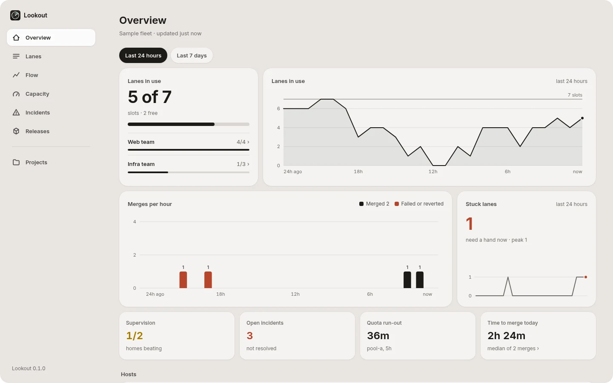
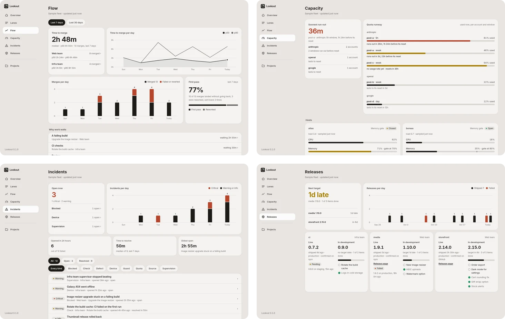
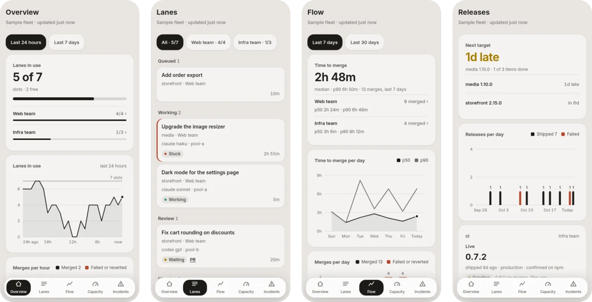

<p align="center">
  
</p>

<h1 align="center">Lookout</h1>

<p align="center"><b>See your agent fleet at a glance.</b><br>
One read-only dashboard for the coding agents you run: which lanes are busy and which are stuck, whether supervision is still beating, how long each account's quota lasts, how work flows to merge, how hot each host is, what broke and what shipped.</p>

<p align="center">
  <picture>
    <source media="(prefers-color-scheme: dark)" srcset="docs/images/overview-dark.webp">
    
  </picture>
</p>

## Quick start

```sh
npx -y lookout-axi serve                          # the bundled sample fleet
npx -y lookout-axi serve --adapter ./fleet.json   # your own fleet
```

Open the `url:` it prints (`http://127.0.0.1:4390` by default). It runs in the foreground until Ctrl-C, needs Node 20 or newer and has no runtime dependencies. From a clone, `npm start` does the same.

## Why

Run more than a few agents and the questions change. It stops being "is this one done?" and becomes "which of twelve lanes is stuck, which account runs dry before lunch, and why is nothing merging?" Each tool answers for its own corner. Lookout answers for the fleet on one page, in plain words, refreshed every 30 seconds.

It never reads your agent tools itself. It reads **one JSON document** that you produce, so it works with any mix of agents, supervisors and hosts, and it can never change anything in your fleet.

## What you see

| Screen | What it answers |
| --- | --- |
| **Overview** | How many lane slots are in use over the last 24 hours or 7 days, merges per hour or day, how many lanes are stuck, and whether supervision, incidents, quota and merge time need you. |
| **Lanes** | Every unit of work as a card on a board from queued to done, with its model, account and state, filtered by workspace. Each card opens its lane page. |
| **Flow** | Time to merge (median and p90) per day and per workspace, merges and failures per day, first-pass rate, and why waiting work waits. |
| **Capacity** | Quota runway per account and window, host CPU, memory and disk with memory gates and heavy jobs, and which test devices are free. |
| **Incidents** | What broke, by severity and kind, whether it is handled, and how long things take to resolve. |
| **Releases** | Per repository, what is live (version, date, channel, link) against what is in development (next version, target, items left). |

<p align="center">
  <picture>
    <source media="(prefers-color-scheme: dark)" srcset="docs/images/screens-dark.webp">
    
  </picture>
</p>

Every screen works on a phone, with a dock for the main screens:

<p align="center">
  <picture>
    <source media="(prefers-color-scheme: dark)" srcset="docs/images/phone-dark.webp">
    
  </picture>
</p>

## Point it at your fleet

An **adapter** is anything that produces the fleet document: a file on disk that a script rewrites, or an `http(s)` URL that returns it. Lookout reads it again on every refresh. A small, complete document:

```json
{
  "schema": "lookout.fleet.v1",
  "generated_at": "2026-10-24T09:00:00Z",
  "name": "My fleet",
  "hosts": [{ "id": "box", "name": "box", "cpu_pct": 41, "mem_pct": 63, "disk_pct": 52,
              "load1": 3.2, "sampled_at": "2026-10-24T09:00:00Z" }],
  "homes": [{ "id": "web", "name": "Web team", "host": "box", "lane_cap": 4,
              "supervision": { "state": "ok", "last_beat_at": "2026-10-24T08:59:30Z" } }],
  "lanes": [{ "id": "l1", "home": "web", "title": "Fix cart rounding",
              "project": "storefront", "stage": "review", "stuck": false,
              "started_at": "2026-10-24T07:10:00Z", "updated_at": "2026-10-24T08:55:00Z" }],
  "workers": [{ "id": "w1", "lane": "l1", "agent": "my-agent", "model": "my-model",
                "account": "pool-a", "state": "waiting",
                "started_at": "2026-10-24T07:10:00Z",
                "last_activity_at": "2026-10-24T08:55:00Z" }],
  "quota": [{ "account": "pool-a", "provider": "my-provider", "window": "5h",
              "used_pct": 72, "resets_at": "2026-10-24T11:00:00Z", "runway_hours": 1.5 }],
  "merges": [],
  "releases": [],
  "incidents": []
}
```

The document holds **hosts** (machines and their load), **homes** (supervised workspaces, each with a lane cap and a supervision heartbeat), **lanes** (units of work), **workers** (agents on lanes), **quota** windows per account, and recent **merges**, **releases** and **incidents**. Optional `history`, `devices` and `plans` fill the Overview charts, the device list and the release targets. Leave out what your fleet does not know; where a chart needs a field the source does not send, Lookout says so instead of guessing.

```sh
npx -y lookout-axi check --adapter ./fleet.json   # valid, or each problem it finds
npx -y lookout-axi contract                       # the contract, field by field
```

The contract is in [docs/adapter.md](docs/adapter.md), and [adapters/sample-fleet/fleet.json](adapters/sample-fleet/fleet.json) is a full example that uses every field.

## Let your agent set it up

Lookout ships a skill that teaches a coding agent to run Lookout and to write, check and serve an adapter for your fleet. Install it into the agents on your machine:

```sh
npx skills add umeranjum17/lookout
```

Or copy [`skills/lookout-axi/`](skills/lookout-axi/SKILL.md) (also inside the npm package) into your agent's skills folder. Then ask: *"Show me my agent fleet in Lookout"* or *"Connect our fleet to Lookout."* The skill defers to `lookout-axi --help` for commands and flags, so an installed copy does not go stale.

## Commands

| Command | Does |
| --- | --- |
| `lookout serve [--adapter <path\|url>] [--port 4390] [--bind 127.0.0.1]` | Serves the dashboard in the foreground. `--port 0` picks a free port. |
| `lookout check [--adapter <path\|url>]` | Checks a document against the contract and lists every problem; exits 1 when it is invalid. |
| `lookout contract` | Prints the adapter contract. |
| `lookout --version`, `lookout --help` | The version, and help for every command. |

The package installs both `lookout` and `lookout-axi`. With no `--adapter`, `serve` and `check` use the bundled sample fleet.

## Safe by default

- **Read-only.** The server answers only GET, and Lookout writes nothing anywhere.
- **Local.** It binds to `127.0.0.1`. Pass `--bind` only when you mean to share it on a network, because the document can name hosts, accounts and work.
- **Self-contained.** The page loads only its own files (a strict content security policy, with the font and UI library bundled), and the only thing the server fetches is your adapter.

## Develop

```sh
npm test           # the adapter contract, the CLI and the server, end to end
bin/run-sample.sh  # serve the sample fleet from this clone
```

The app is plain modules in `app/` with no build step; `lib/contract.js` is the contract checker and `lib/source.js` reads the adapter.

## License

[MIT](LICENSE)
