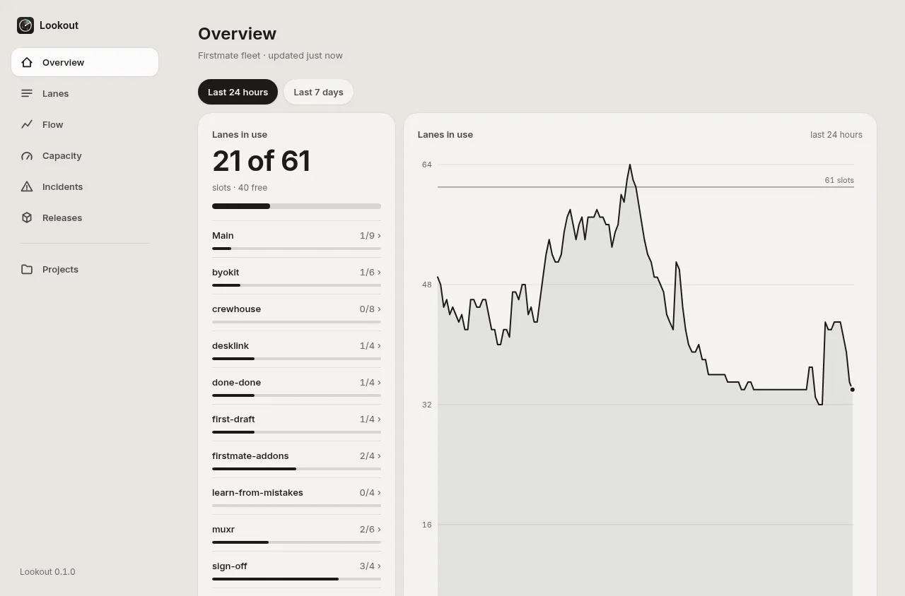

<div align="center">

<picture>
  <source media="(prefers-color-scheme: dark)" srcset="docs/images/lookout-logo-dark.svg">
  
</picture>
<h1>Lookout</h1>

**Know which coding agents need you before work stalls.**

A read-only fleet dashboard for people running agents across workspaces, accounts and hosts.

<picture>
  <source media="(max-width: 600px) and (prefers-color-scheme: dark)" srcset="docs/images/hero-phone-dark.webp">
  <source media="(max-width: 600px)" srcset="docs/images/hero-phone-light.webp">
  <source media="(prefers-color-scheme: dark)" srcset="docs/images/hero-dark.webp">
  
</picture>

[Quick start](#quick-start) · [Connect your fleet](docs/setup.md) · [Adapter reference](docs/adapter.md) · [Agent skill](skills/lookout-axi/SKILL.md)

[](https://www.npmjs.com/package/lookout-axi) [](https://github.com/umeranjum17/lookout/actions/workflows/ci.yml)

</div>

## Quick start

Requires Node.js 20 or newer. Run these three commands in a terminal:

```sh
npx -y lookout-axi --version
npx -y lookout-axi check
npx -y lookout-axi serve
```

Open **http://127.0.0.1:4390**. You start with the bundled sample fleet shown above; stop the server with Ctrl-C. No account or fleet connection is needed to explore it.

To show your own work, [produce a fleet JSON document](docs/setup.md) and run `npx -y lookout-axi serve --adapter ./fleet.json`.

## Why Lookout

| Your question | Checking by hand | With Lookout |
| --- | --- | --- |
| Which work needs me? | Open each workspace and inspect its status. | Scan a lane board with stages, workers and stuck work. |
| Will capacity last? | Check account windows and host load separately. | Read quota runway, CPU, memory and disk together. |
| Why is nothing shipping? | Reconstruct merges, failures and release status. | Follow merge time, waiting reasons and releases across the fleet. |

Lookout reads one JSON document from a file or URL and refreshes every 30 seconds. Your adapter decides where the data comes from. The dashboard sends no commands to your agents.

## What you get

| **Find the work that needs a hand** | **See what limits the fleet** |
| --- | --- |
| Lanes move from queued to done, with a detail page for each lane and filters by workspace. | Capacity brings account quota, host load, memory gates, heavy jobs and test devices together. |
| **Understand the path to merge** | **Track trouble and releases** |
| Flow shows median and p90 merge time, first-pass rate and reasons work is waiting. | Incidents show severity and resolution; releases compare what is live with what is in development. |

<picture>
  <source media="(prefers-color-scheme: dark)" srcset="docs/images/screens-dark.webp">
  
</picture>

## Try it, inspect it, verify it

The captures show **bundled sample data**, not customer activity. The [sample adapter](adapters/sample-fleet/fleet.json) is included in the [published npm package](https://www.npmjs.com/package/lookout-axi), so you can run the same dashboard yourself.

- [Integration checks](test/) exercise the adapter contract, CLI and HTTP server; [CI runs them on every pull request](https://github.com/umeranjum17/lookout/actions/workflows/ci.yml).
- [The adapter contract](docs/adapter.md) documents the inputs behind the charts. Missing inputs are identified rather than guessed.
- The dashboard ships its font and UI library locally and has no runtime package dependencies.

## Local and read-only

The server binds to `127.0.0.1` and only accepts GET requests. It reads your adapter and writes nothing to your fleet. Pass `--bind` only when you intend to share the dashboard: the document can name hosts, accounts and work.

Lookout displays the data your adapter provides; it does not discover agents or calculate quota runway for you. See [adapter setup and CLI options](docs/setup.md) for file and URL sources, validation, and the bundled agent skill.

## Develop

```sh
npm test
npm pack --dry-run
npm start
```

Plain JavaScript modules, no build step. See [the adapter reference](docs/adapter.md) to add a data source.

[MIT license](LICENSE).
